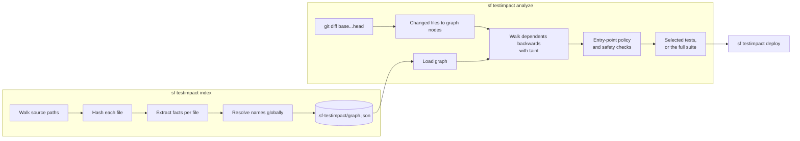
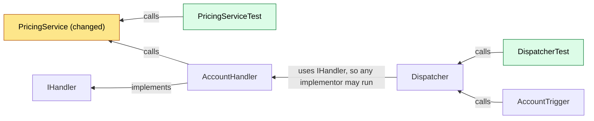

# How it works

`sf-testimpact` answers one question: **which Apex test classes could a change affect?** It
builds a dependency graph of your Apex and metadata, maps your git diff onto that graph,
walks backwards from what changed to everything that depends on it, and selects the test
classes it reaches.

The rule behind every decision: **over-approximate freely, under-approximate never.** An
extra test costs minutes. A missed test lets a regression through. So anything the tool
cannot see clearly makes it select more tests or run all of them, and it prints the rule
that decided.

## The index

`sf testimpact index` walks your [source paths](configuration.md#sourcepaths), skipping
`node_modules`, `.git`, `.sf`, `.sfdx` and `.sf-testimpact`, and hands each file it models to
an extractor:

| Files | What becomes a node | What becomes an edge |
| --- | --- | --- |
| `.cls`, `.trigger` | Classes, interfaces, enums, inner types, triggers | Type references, `extends`, `implements`, SOQL reads, DML, describe calls, trigger objects, custom labels, custom permissions, static resources, parsed from the Apex syntax tree |
| `*.object-meta.xml`, `*.field-meta.xml`, `*.validationRule-meta.xml` | Objects, fields, validation rules | A field belongs to its object; formulas, validation rules and roll-up summaries reference the fields they read |
| `*.flow-meta.xml` | Flows | Apex actions the flow calls; objects and fields it touches; labels |
| `*.permissionset-meta.xml`, `*.profile-meta.xml`, `*.permissionsetgroup-meta.xml` | Permission sets and profiles | Classes, objects, fields and custom permissions they grant |
| `*.labels-meta.xml` | One node per custom label | — |
| `*.customPermission-meta.xml` | Custom permissions | — |
| `*.translation-meta.xml`, `*.objectTranslation-meta.xml` | Translations | The labels and fields they translate |
| `*.resource-meta.xml` | Static resources | — |

A file that belongs to one of those, such as a class's `.cls-meta.xml` or a file inside a
static-resource bundle, maps to that component's nodes. Any other file type, such as a
layout, an LWC component or a DataWeave script, is **not modelled**. What happens when one
changes is covered under [safety checks](#safety-checks).

Edges point from the dependent to its dependency: "`AccountHandler` uses `PricingService`".
Names are resolved globally after every file is read. A reference that could mean more than
one thing gets an edge to every candidate: ambiguity widens, it never picks. A call through
an interface or abstract class also gets an edge to every implementation, because any of
them could run.

The index stores each file's extracted facts with a hash of its contents. Running `index`
again re-extracts only the files whose hash changed, and the result is identical to a full
rebuild. The index also records which build wrote it. If a later build would extract
differently, after a plugin upgrade for example, `index` re-parses every file, and `analyze`
falls back to the full suite until it has.

## From a diff to changed nodes

`analyze --base main` runs `git diff --name-status --find-renames --relative main...HEAD` in
the project root. The three dots compare against the point where your branch forked, so the
change set is what your branch did, not what has also landed on `main` since. A rename
becomes a deletion of the old path and an addition of the new one.

`--relative` makes git report paths from the project root, as the index stores them, and
leave out changes outside the project. That matters when the sfdx project sits in a
subdirectory of its repository. Before 1.3.1 the paths came from the repository root, matched
nothing in the index, and every change in such a project was ignored
([before and after](measurements/fixes-1.3.1-before-after.txt)).

Because you index the branch, a file the branch adds is in the index, and a file it deletes
or renames away is not. A deleted Apex class therefore makes the run fall back, rather than
guess what used to depend on it. That costs a full run, never a missed test.

Each changed path is then handled in this order:

1. `sfdx-project.json` or `.sf-testimpact.yml` changed: these decide what is indexed and how,
   so the whole run falls back.
2. The path matches [`excludeFromImpact`](configuration.md#excludefromimpact): it is ignored.
3. The path is outside every source path, like a CI workflow or a README: it is ignored,
   because it cannot be deployed.
4. The path declares nodes in the index, directly or as a member of a component: those nodes
   are the **seeds** of the walk.
5. Otherwise it is either a modelled file the index has not seen, or a type that is not
   modelled. Either one falls back by default.

## Walking backwards

From the seeds, the analysis walks every edge in reverse, collecting everything that
depends on a changed node, then everything that depends on those, until nothing new is
found. This is the **impacted set**. It is complete rather than minimal: every path to a
changed node is followed.

Here is the repository's sample project with one change to `PricingService`. Arrows point
from the dependent to what it uses, and the walk runs against them:

`PricingServiceTest` calls the changed class directly. `DispatcherTest` is three steps away:
it calls `Dispatcher`, which calls an `IHandler`, which `AccountHandler` implements, and
`AccountHandler` calls `PricingService`. Both are selected.

## Taint: code the graph cannot follow

Some code chooses its target at runtime: `Type.forName(name)`, `Database.query(soql)`,
`record.get(fieldName)`. No edge can say where those go. Instead the class holding the
construct is **tainted** in a domain, and when the walk reaches any node of that domain's
kind, the domain **activates** and every tainted class joins the impacted set.

| Domain | Constructs that taint a class | Activated when the walk reaches |
| --- | --- | --- |
| `apexType` | `Type.forName`, `Type.newInstance`, `Callable.call`, `Database.executeBatch`, `System.enqueueJob`, `System.schedule`, `System.scheduleBatch`, `FeatureManagement.checkPermission` with a computed name | An Apex class, inner class or trigger |
| `sobjectAny` | `Database.query`, `Database.countQuery` and `Database.getQueryLocator`, each with its `WithBinds` form; `Search.query`; SOSL; `Schema.getGlobalDescribe` | An object or field |
| `fieldAny` | `get`, `put`, `getSObject` and `putSObject` on an SObject, `getPopulatedFieldsAsMap` | An object or field |
| `resourceAny` | `Test.loadData` or `setStaticResource` with a computed resource name | A static resource |

An Apex file that cannot be parsed is tainted in `apexType`, `sobjectAny` and `fieldAny`,
because nothing is known about what it references.

The domain activates on any node the walk *reaches*, not only on the changed ones. In the
example, `PricingService` activates `apexType`, which pulls in `Dispatcher` because it calls
`Type.forName`. Had the change been to a field that `PricingService` reads, the walk would
reach `PricingService` from the field, and the domain would activate there.

Each activation prints a `WIDEN` line naming the domain and the node that activated it. To
run the full suite instead of widening, set
[`taint.dynamicApex` or `taint.dynamicSoql`](configuration.md#taintdynamicapex) to `full`.

## Entry points

An **entry point** is a class the platform or an outside caller can invoke without going
through anything in your repository. The graph cannot see those callers, so "only these
tests depend on it" is not something it can claim.

| Kind | What makes a class one |
| --- | --- |
| `trigger` | Every trigger |
| `rest` | `@RestResource`, or a method annotated `@HttpGet`, `@HttpPost`, `@HttpPut`, `@HttpDelete` or `@HttpPatch` |
| `aura` | A method annotated `@AuraEnabled` |
| `invocable` | A method annotated `@InvocableMethod` |
| `future` | A method annotated `@future` |
| `remote` | A method annotated `@RemoteAction` |
| `global` | The `global` modifier, on the class or on a method |
| `schedulable` | Implements `Schedulable` |
| `batchable` | Implements `Database.Batchable` |
| `queueable` | Implements `Queueable` |
| `email` | Implements `Messaging.InboundEmailHandler` |

When the impacted set contains an entry point,
[`entryPointPolicy`](configuration.md#entrypointpolicy) decides what happens:

| Policy | What happens | Printed as |
| --- | --- | --- |
| `full` (default) | The whole run falls back to the full suite. When this is the only reason, the output also says what `widen` would have selected on your code. | `FALLBACK entry-point-policy-full` |
| `widen` | Every other entry point that shares a kind with an impacted one is added to the seeds, and the walk runs again. An outside caller may reach the same subsystem through any of them. | `WIDEN entry-point-policy-widen` |
| `strict` | The graph is trusted. Outside callers are invisible to the selection. | `INFO entry-point-policy-strict` |

## Selection

The selected test classes are the union of:

- every test class in the impacted set, shown without a marker;
- every test class annotated `@IsTest(SeeAllData=true)`, on the class or on any test method,
  shown as `[see-all-data]`. They read org data that is not in git, so no change can be shown
  not to affect them;
- every test class whose file path matches [`alwaysRun`](configuration.md#alwaysrun), shown as
  `[always-run]`.

A test class is any class annotated `@IsTest`, or with a method annotated `@IsTest` or
declared `testMethod`.

## Safety checks

The run falls back to the full suite, at [`fullTestLevel`](configuration.md#fulltestlevel),
whenever any of these fires. Each prints a `FALLBACK` line naming the rule and the file or
class responsible:

| Condition | Rule |
| --- | --- |
| The index was written by a different build | `graph-stale-*` |
| `sfdx-project.json` or `.sf-testimpact.yml` changed | `project-config-changed` |
| A changed file could not be parsed | `changed-file-parse-failed` |
| A changed modelled file is not in the index | `changed-file-not-in-index` |
| A changed file is a type the tool does not model | `unmodelled-file-type` |
| An entry point is impacted, under `entryPointPolicy: full` | `entry-point-policy-full` |
| A dynamic construct is reached, under `taint.dynamicApex` or `taint.dynamicSoql: full` | `dynamic-apex-full`, `dynamic-soql-full` |
| The selection skips more than `maxReductionPercent` of tests, under `onExceed: fail` or `runAll` | `max-reduction-exceeded-*` |

Several have a less conservative setting, which [configuration](configuration.md) documents
alongside its trade. [Rules and error codes](rules.md) lists every rule with what to do
about it.

The **reduction circuit breaker** is not an optimiser. It exists for the failure where a bug
collapses the graph and the tool reports "2 tests needed" for a 300-file change. If the
selection would skip more than `maxReductionPercent` of tests (95% by default), it warns,
or with `onExceed: fail` or `runAll` it runs everything.

## Coverage under RunSpecifiedTests

A production deployment with `RunSpecifiedTests` needs every class in the deployment at 75%
coverage from the tests that run. Because the walk is complete, the selection contains every
test with a path to each changed class. Each changed class is therefore covered exactly as it
would be under `RunLocalTests`. `deploy` checks that property before deploying, rather than
assuming it.

The argument holds only if the graph knows every caller, and it breaks in specific ways,
most importantly when the org contains test classes the repository does not.
[Limitations](limitations.md#coverage-under-runspecifiedtests) covers each one, and
`deploy --verify-coverage` checks for the org-side case.

## What it cannot see

Changes to Flows, permission sets and translations select no tests, because their edges point
*to* Apex and the walk goes the other way. Managed-package code, org-only test classes,
dynamic dispatch the tool does not recognise, and behaviour driven by org data are invisible
too. [Limitations](limitations.md) lists all of them, mitigated or not.
